# FleetBridge — Enterprise Architecture & Design Book
**Document Classification:** Technical Architecture Reference  
**Project:** FleetBridge — Enterprise B2B Employee Transportation Management Platform  
**Version:** 1.0.0  
**Date:** July 2026  
**Audience:** Software Architects, Backend/Frontend/Mobile Developers, Data Engineers, DevOps, QA, Security Engineers  

---

## Table of Contents
1. [Architecture Overview](#1-architecture-overview)
2. [Architecture Principles](#2-architecture-principles)
3. [Context Diagram (C4 Level 1)](#3-context-diagram-c4-level-1)
4. [Container Diagram (C4 Level 2)](#4-container-diagram-c4-level-2)
5. [Component Diagrams (C4 Level 3)](#5-component-diagrams-c4-level-3)
6. [Domain Driven Design](#6-domain-driven-design)
7. [Use Case Diagrams](#7-use-case-diagrams)
8. [Activity Diagrams](#8-activity-diagrams)
9. [Sequence Diagrams](#9-sequence-diagrams)
10. [Class Diagrams](#10-class-diagrams)
11. [ER Diagram](#11-er-diagram)
12. [Database Per Service](#12-database-per-service)
13. [State Diagrams](#13-state-diagrams)
14. [Deployment Diagram](#14-deployment-diagram)
15. [Network Architecture](#15-network-architecture)
16. [Event Driven Architecture](#16-event-driven-architecture)
17. [API Interaction Diagrams](#17-api-interaction-diagrams)
18. [Authentication Architecture](#18-authentication-architecture)
19. [Security Architecture](#19-security-architecture)
20. [Observability Architecture](#20-observability-architecture)
21. [Scalability Architecture](#21-scalability-architecture)
22. [Resilience Architecture](#22-resilience-architecture)
23. [Decision Records (ADRs)](#23-decision-records)
24. [Glossary](#24-glossary)

---

## 1. Architecture Overview
FleetBridge is an enterprise-grade, multi-tenant B2B SaaS platform designed to orchestrate corporate employee transportation. 
- **Business Architecture:** Connects Organizations (demand) with Travel Companies (supply), governed by a Super Admin (platform owner). Monetization is multi-tiered SaaS billing.
- **Application Architecture:** Microservices-based, following Hexagonal/Clean Architecture, coordinated via an API Gateway.
- **Information Architecture:** Multi-tenant data models using Row-Level Security (RLS) in PostgreSQL. Event-sourced data integration. Time-series storage for telemetry.
- **Infrastructure Architecture:** Cloud-native, containerized (Docker), and orchestrated via Kubernetes (AWS EKS) across multi-Availability Zones.
- **Security Architecture:** Zero Trust model, JWT/OAuth2 Identity via Keycloak, mTLS for internal communication.
- **Integration Architecture:** Event-Driven Architecture (EDA) via Apache Kafka for asynchronous workflows. Synchronous communication via REST/gRPC where immediate consistency is required.

---

## 2. Architecture Principles
- **SOLID & Clean Architecture:** Domain logic is isolated at the core. External concerns (DB, Web) are decoupled via ports and adapters.
- **Domain-Driven Design (DDD):** System is decomposed into Bounded Contexts aligned with business capabilities (e.g., Trip, Fleet, Billing).
- **Event-Driven Architecture (EDA):** State changes publish domain events to Kafka, ensuring loose coupling and eventually consistent downstream processing (e.g., Analytics, Billing).
- **Database Per Service:** Each microservice encapsulates its data store. No direct cross-database queries.
- **API First & Cloud Native:** 12-Factor App methodology. Ephemeral containers, externalized configuration, stateless processes.
- **High Cohesion, Loose Coupling:** Services operate independently. Failure in the Notification service does not halt Trip execution.

---

## 3. Context Diagram (C4 Level 1)

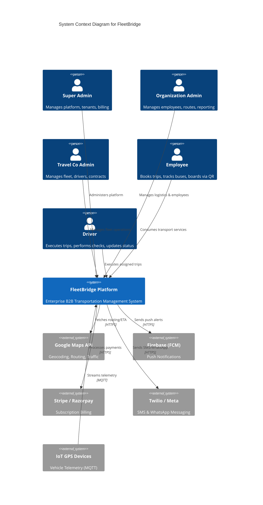
**Explanation:** The Context diagram illustrates FleetBridge's boundaries, showing the 5 primary user personas and the 5 critical external integrations required to deliver the core value proposition.

---

## 4. Container Diagram (C4 Level 2)

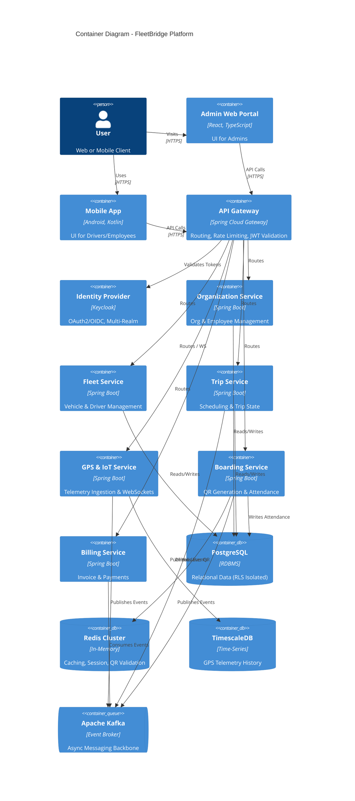
**Explanation:** Displays the macro-architecture. Web and Mobile clients route through a Spring Cloud Gateway which handles authentication offloading to Keycloak. Core business logic is partitioned into microservices, each with its dedicated persistence layer. Kafka acts as the event nerve center.

---

## 5. Component Diagrams (C4 Level 3)

### Example: Trip Service Component Diagram
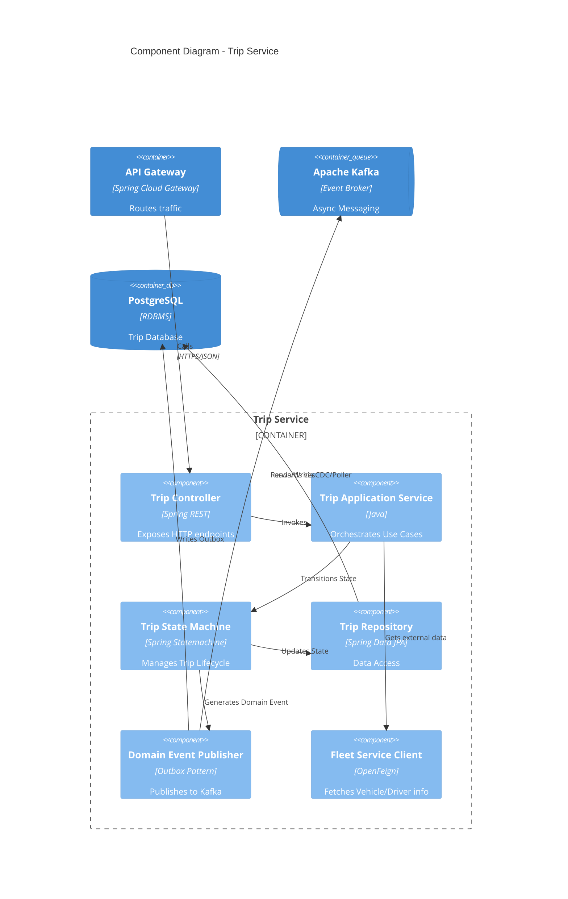
**Explanation:** The Trip Service follows Hexagonal architecture. `TripController` acts as the primary driving adapter. `TripApplicationService` orchestrates logic using the `TripStateMachine`. Data is persisted via `TripRepository`. External communication utilizes Feign (synchronous) and Kafka (asynchronous via the Outbox pattern).

---

## 6. Domain Driven Design

### 6.1 Bounded Context Mapping
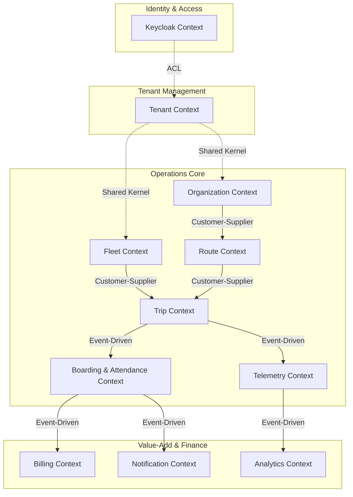
**Explanation:** Identifies the strategic design of the platform. The `Trip Context` is central to Operations, consuming data from `Route` and `Fleet` contexts via Customer-Supplier relationships. Downstream contexts like `Billing` and `Notification` react to events from `Boarding` and `Trip`.

### 6.2 Ubiquitous Language & Entities
- **Aggregate Root (Trip):** Encapsulates Trip schedule, state (SCHEDULED, IN_PROGRESS, COMPLETED), assigned Vehicle, and Driver.
- **Value Object (GeoCoordinate):** Immutable latitude, longitude, and accuracy radius.
- **Domain Event (`TripCompletedEvent`):** Signifies a trip has ended, triggering attendance finalization and billing cycles.

---

## 7. Use Case Diagrams

### 7.1 Employee Use Cases
```mermaid
usecaseDiagram
    actor Employee as "Employee"
    
    usecase UC1 as "View Assigned Route"
    usecase UC2 as "Track Bus Live Location"
    usecase UC3 as "Generate QR Boarding Pass"
    usecase UC4 as "Mark Transport Leave"
    usecase UC5 as "Trigger SOS Emergency"
    usecase UC6 as "Submit Trip Feedback"
    
    Employee --> UC1
    Employee --> UC2
    Employee --> UC3
    Employee --> UC4
    Employee --> UC5
    Employee --> UC6
    
    UC2 .> UC1 : <<extends>>
    UC5 .> UC2 : <<includes>>
```

### 7.2 Travel Company Admin Use Cases
```mermaid
usecaseDiagram
    actor TravelAdmin as "Travel Co Admin"
    
    usecase UC1 as "Register Vehicle"
    usecase UC2 as "Onboard Driver"
    usecase UC3 as "Assign Driver to Trip"
    usecase UC4 as "Monitor Fleet Live"
    usecase UC5 as "Review Invoices"
    
    TravelAdmin --> UC1
    TravelAdmin --> UC2
    TravelAdmin --> UC3
    TravelAdmin --> UC4
    TravelAdmin --> UC5
```
**Explanation:** Illustrates the high-level functional goals of primary actors. `<<includes>>` denotes mandatory sub-behavior, while `<<extends>>` denotes optional extension.

---

## 8. Activity Diagrams

### 8.1 Trip Execution & Boarding Workflow
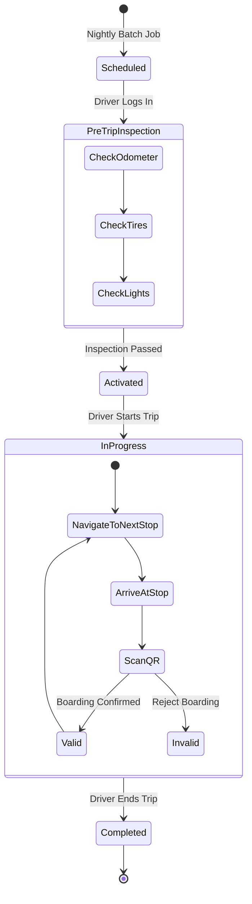
**Explanation:** Details the step-by-step operational flow of a single trip, emphasizing the mandatory Pre-Trip Inspection and the iterative boarding loop at each stop.

---

## 9. Sequence Diagrams

### 9.1 QR Boarding & Attendance Verification
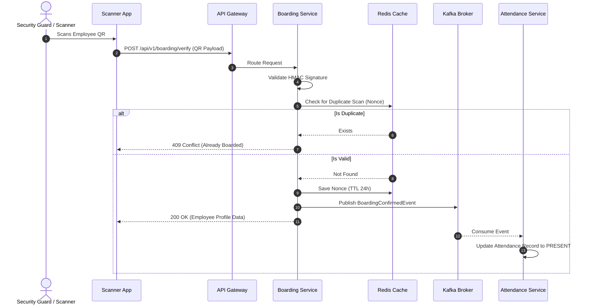
**Explanation:** Shows the synchronous validation loop optimized by Redis for sub-100ms response, decoupled from the asynchronous attendance database write via Kafka.

---

## 10. Class Diagrams

### 10.1 Trip & Route Aggregate Model
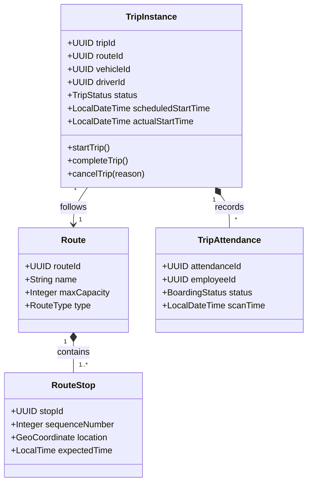
**Explanation:** Illustrates the enterprise domain model. `TripInstance` acts as an aggregate root for operational execution, maintaining relationships with the reference `Route` and its compositional `RouteStop`s.

---

## 11. ER Diagram

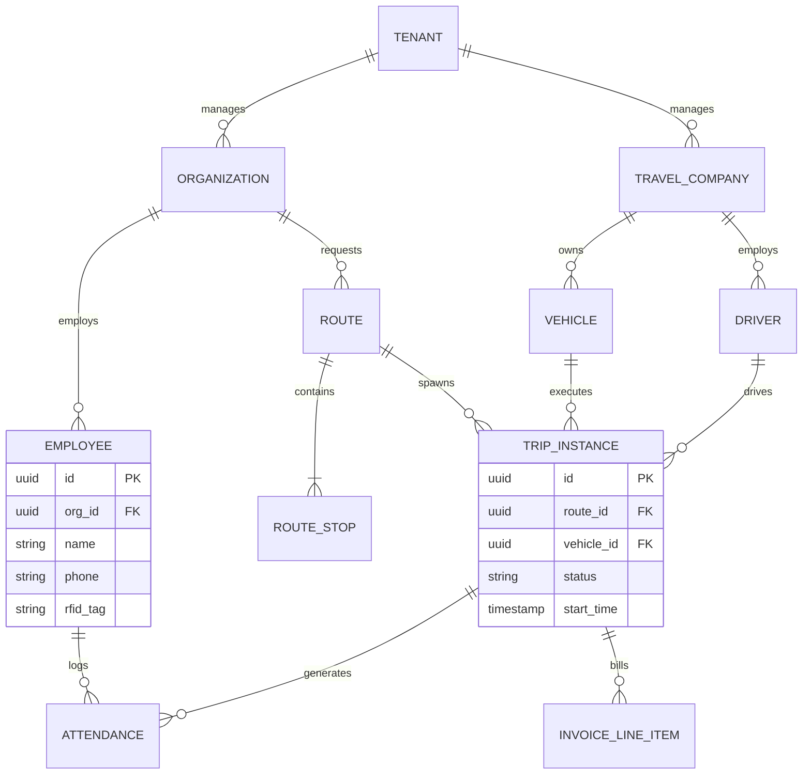
**Explanation:** A macro-level logical data model indicating relationships across entities. In practice, these tables are physically segregated into different microservice databases, with foreign keys (`route_id`, `vehicle_id`) acting as soft references.

---

## 12. Database Per Service
To ensure loose coupling, FleetBridge implements the **Database-per-Service** pattern.
- **Tenant DB:** Manages tenant metadata, domains, and Keycloak realm mappings.
- **Organization DB:** Employee records, departments, cost centers.
- **Fleet DB:** Vehicles, Drivers, maintenance logs, documents.
- **Trip DB:** Routes, route variants, schedules, trip instances.
- **Telemetry DB (TimescaleDB):** Raw GPS pings, geofence breaches. Highly optimized for time-series inserts.
- **Billing DB:** Contracts, invoices, payment records.
- **Shared References:** Services keep eventually consistent Read Models of necessary external data (e.g., Trip DB keeps a localized cache of Vehicle capacity) populated via Kafka events.

---

## 13. State Diagrams

### 13.1 Vehicle State Machine
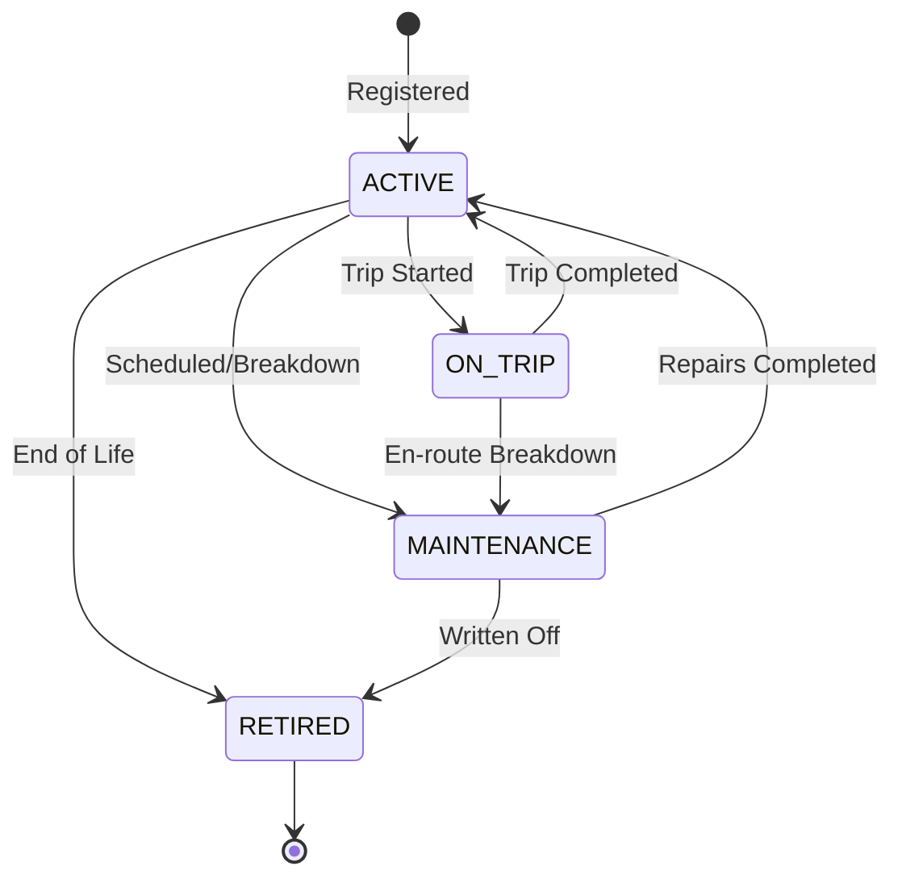
**Explanation:** Ensures a vehicle cannot be assigned to a new trip while `ON_TRIP` or under `MAINTENANCE`. State transitions are enforced by the Fleet Service Application Layer.

---

## 14. Deployment Diagram

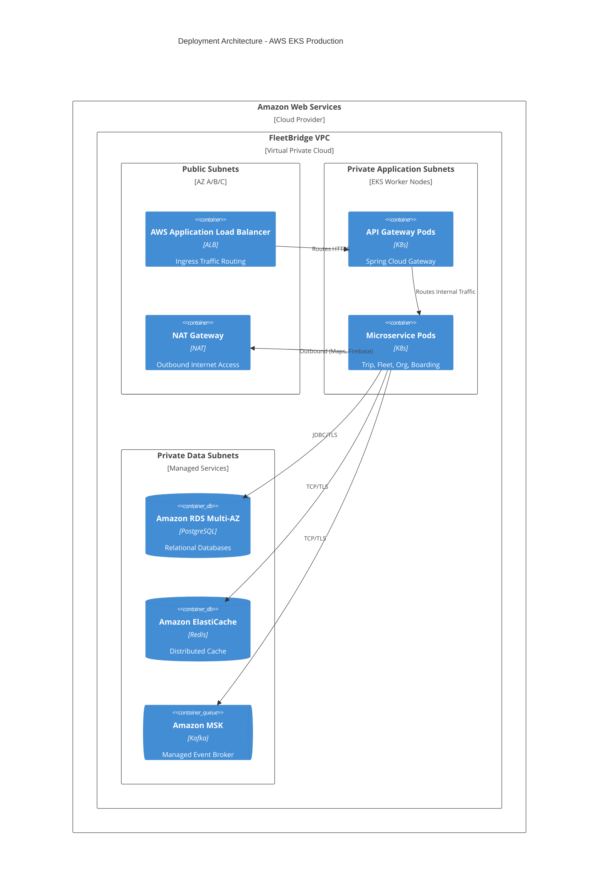
**Explanation:** Follows strict 3-tier cloud architecture. Public subnets hold ALBs/NAT. Private subnets hold EKS worker nodes (applications). Data subnets are deeply isolated, containing managed AWS data services.

---

## 15. Network Architecture
- **VPC & Subnets:** Custom VPC with /16 CIDR. Subnet separation across 3 Availability Zones for High Availability.
- **Security Groups:** 
  - ALB SG: Allows 443 inbound from 0.0.0.0/0.
  - EKS Worker SG: Allows inbound from ALB SG on NodePorts.
  - Data SG: Allows inbound ONLY from EKS Worker SG on specific ports (5432, 6379, 9092).
- **Zero Trust:** Istio Service Mesh implements mTLS between all Kubernetes pods. Pod-to-pod traffic is encrypted and authenticated.

---

## 16. Event Driven Architecture

### 16.1 Transactional Outbox Pattern implementation
To guarantee at-least-once delivery of domain events without distributed two-phase commits (2PC):
1. Microservice initiates DB transaction.
2. Persists business entity (e.g., `TripInstance`).
3. Persists domain event to local `outbox_event` table.
4. Commits transaction.
5. Debezium CDC (Change Data Capture) tails the PostgreSQL WAL (Write-Ahead Log) and publishes the event to Kafka.

### 16.2 Key Kafka Topics
- `fleetbridge.domain.employee` (Partitioned by `tenant_id`)
- `fleetbridge.domain.trip` (Partitioned by `trip_id`)
- `fleetbridge.telemetry.gps` (Partitioned by `vehicle_id` - high throughput)
- `fleetbridge.ops.boarding` (Partitioned by `trip_id`)

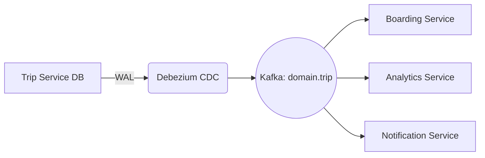

---

## 17. API Interaction Diagrams
- **Synchronous (REST/Feign):** Used for querying data (e.g., UI loading dashboards, Boarding Service validating token). Wrapped in Resilience4j Circuit Breakers to prevent cascading failures.
- **Asynchronous (Kafka):** Used for state mutations and notifications.
- **WebSocket (STOMP):** Used for streaming real-time GPS coordinates from the API Gateway to connected browser/mobile clients.

---

## 18. Authentication Architecture

### 18.1 OAuth2 / OIDC Flow (Keycloak)
1. Mobile App requests auth via Authorization Code Flow with PKCE.
2. Keycloak renders tenant-specific login page.
3. User authenticates (Password + OTP).
4. Keycloak issues JWT Access Token, ID Token, Refresh Token.
5. Client includes JWT in `Authorization: Bearer` header.
6. API Gateway validates JWT signature locally using cached JWK Set from Keycloak.
7. Gateway extracts `tenantId` and roles, injecting them as custom HTTP headers to backend microservices.

---

## 19. Security Architecture
- **Threat Model Mitigation (OWASP Top 10):**
  - **Injection:** Prevented by Spring Data JPA/Hibernate (Parameterized queries) and REST payload validation.
  - **Broken Auth:** Handled by Keycloak (brute force protection, token rotation).
  - **Sensitive Data Exposure:** AWS KMS for DB volume encryption. Field-level encryption for Employee PII. TLS 1.3 in transit.
- **Rate Limiting:** Redis Token Bucket algorithm at API Gateway. 100 req/min for Web, 1000 req/min for IoT MQTT.
- **Audit Logging:** Dedicated aspect-oriented (AOP) audit logger captures every mutable action (actor, entity, old_state, new_state) and publishes to `domain.audit` topic for Elasticsearch indexing.

---

## 20. Observability Architecture

### 20.1 Telemetry Pipeline
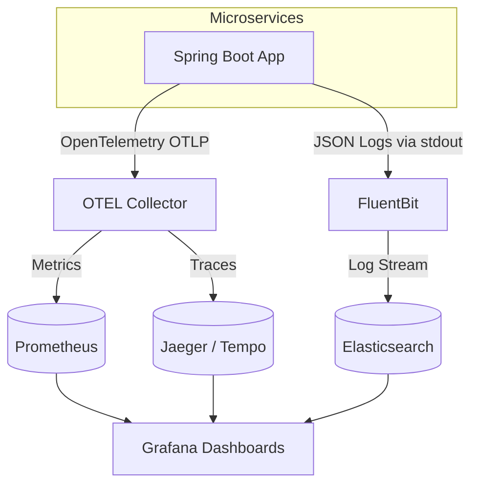
- **Logging:** Structured JSON logging (Logback). MDC injects `traceId`, `spanId`, and `tenantId` into every log line.
- **Metrics:** Micrometer exposes JVM, connection pool, and custom business metrics (e.g., `active_trips_count`, `sos_triggers_total`) to Prometheus scrape endpoints.
- **Alerting:** Grafana Alertmanager triggers PagerDuty for critical SLA breaches (e.g., API latency > 500ms, Kafka consumer lag > 10,000).

---

## 21. Scalability Architecture
- **Horizontal Pod Autoscaling (HPA):** Kubernetes scales microservice pods based on CPU/Memory utilization (target 70%).
- **Database Scalability:** PostgreSQL Read Replicas deployed. Spring `@Transactional(readOnly = true)` routes queries to replicas.
- **Telemetry Ingestion:** GPS Service scales horizontally to handle high MQTT connection counts. TimescaleDB partitions time-series data into chunks (Hypertables) for high-speed writes.

---

## 22. Resilience Architecture
- **Circuit Breakers (Resilience4j):** Wraps all inter-service REST calls.
- **Timeouts:** Global 5-second timeout on all synchronous internal calls.
- **Retries:** Configured for transient failures (e.g., network blip) with exponential backoff.
- **Dead Letter Queues (DLQ):** Unprocessable Kafka messages are routed to a DLQ for manual inspection, preventing poison-pill blocking of consumer partitions.
- **Graceful Degradation:** If Analytics Service is down, Admin Portals serve stale cached data instead of crashing.

---

## 23. Decision Records (ADRs)

### ADR 001: Selection of Microservices Architecture
- **Context:** The platform serves multiple enterprises with disparate scaling needs (GPS telemetry vs. Billing).
- **Decision:** Adopt a Microservices Architecture.
- **Trade-offs:** Increases operational complexity and CI/CD overhead, but provides independent scaling, fault isolation, and technology flexibility.

### ADR 002: PostgreSQL Row-Level Security (RLS) for Multi-Tenancy
- **Context:** Need strict data isolation between corporate tenants without the overhead of maintaining thousands of separate databases.
- **Decision:** Use PostgreSQL with RLS. The `tenantId` is injected into the DB connection context via API Gateway.
- **Trade-offs:** Adds slight overhead to query execution. Excellent security boundary; prevents application bugs from leaking cross-tenant data.

### ADR 003: TimescaleDB for GPS Telemetry
- **Context:** High volume (millions per day) of GPS coordinates needing fast inserts and time-window aggregations.
- **Decision:** Use TimescaleDB (PostgreSQL extension).
- **Trade-offs:** Reduces infrastructure complexity compared to deploying a separate Cassandra or InfluxDB cluster, while maintaining SQL querying capabilities.

### ADR 004: React (Admin) & Kotlin Jetpack Compose (Mobile)
- **Context:** Need performant, maintainable UI layers.
- **Decision:** React 18 for Web due to rich component ecosystem (shadcn/ui). Native Kotlin with Jetpack Compose for Android to leverage deep hardware access (Maps, Background location, WorkManager for offline sync).

---

## 24. Glossary
- **Clean Architecture:** A software design philosophy emphasizing separation of concerns, keeping core business logic independent of frameworks or databases.
- **Event Choreography:** A decentralized event-driven pattern where microservices react to events independently, without a central controller orchestrator.
- **OTLP:** OpenTelemetry Protocol. The standard format for transmitting telemetry data (logs, metrics, traces).
- **PKCE:** Proof Key for Code Exchange. A security extension for OAuth2 designed to protect mobile apps from authorization code interception attacks.
- **Saga Pattern:** A sequence of local transactions managing data consistency across microservices in distributed systems.

---
*End of Document*
