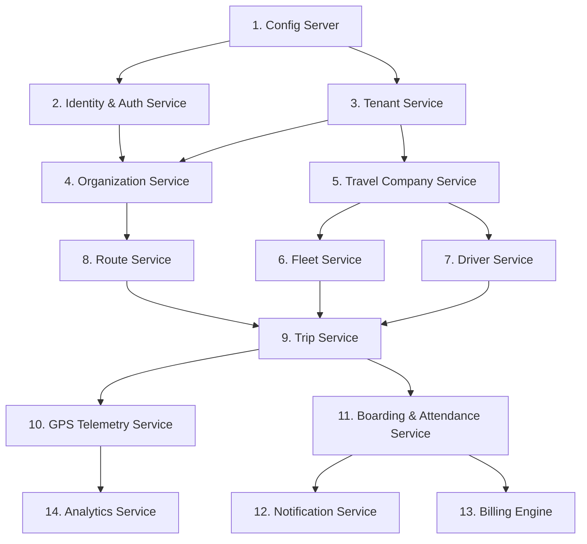
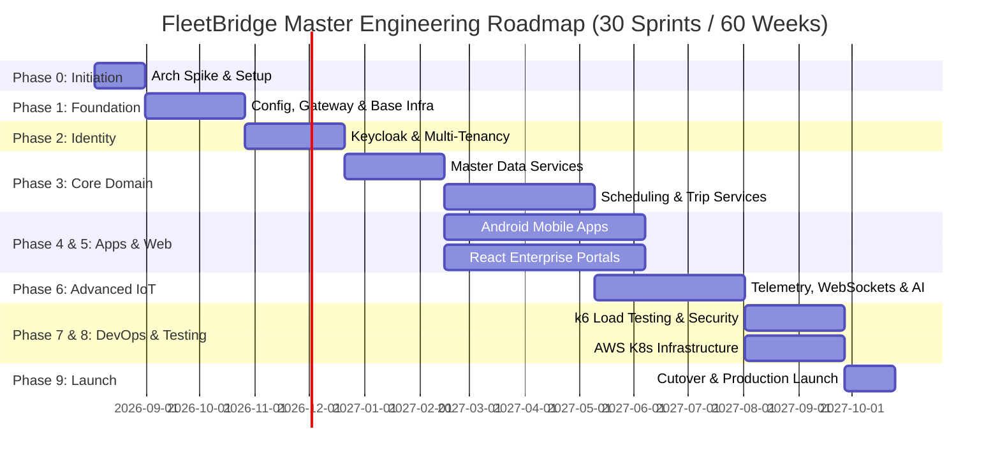

# FleetBridge — Enterprise Master Engineering Implementation Roadmap
**Document Classification:** Engineering Execution Playbook & Technical Roadmap  
**Target Platform:** FleetBridge Enterprise B2B Employee Transportation SaaS  
**Version:** 1.0.0  
**Date:** July 2026  
**Audience:** Solution Architects, Engineering Leads, Backend/Frontend/Mobile Developers, DevOps Engineers, QA Automation Teams, Technical Program Managers  

---

## Executive Summary & Engineering Philosophy

This document defines the end-to-end engineering implementation strategy for **FleetBridge** — an enterprise-grade multi-tenant B2B Employee Transportation Management SaaS Platform.

The roadmap converts the functional requirements (SRS) and architecture blueprints into an actionable, sprint-by-sprint engineering execution playbook. 

```
               PROJECT ROADMAP TIMELINE OVERVIEW
┌─────────────────────────────────────────────────────────────────┐
│ Sprints 1-2   : Phase 0 (Initiation, Setup & Standards)         │
│ Sprints 3-6   : Phase 1 (Core Platform Foundation & Infrastructure)│
│ Sprints 7-10  : Phase 2 (Identity, Security & Multi-Tenancy)     │
│ Sprints 11-20 : Phase 3 (Core Domain Microservices Engine)       │
│ Sprints 17-24 : Phase 4 & 5 (Android Mobile & Web Dashboards)   │
│ Sprints 21-26 : Phase 6 (Advanced Features: Telemetry, AI, IoT)   │
│ Sprints 25-28 : Phase 7 & 8 (Testing, Hardening & DevOps/K8s)    │
│ Sprints 29-30 : Phase 9 (Production Readiness & Go-Live)        │
└─────────────────────────────────────────────────────────────────┘
```

---

# Table of Contents

1. [Development Methodology & Engineering Governance](#1-development-methodology--engineering-governance)
2. [Team Structure & RACI Matrix](#2-team-structure--raci-matrix)
3. [Microservice Implementation Sequence & Dependency Graph](#3-microservice-implementation-sequence--dependency-graph)
4. [Phase 0: Project Initiation & Architecture Setup](#4-phase-0-project-initiation--architecture-setup)
5. [Phase 1: Platform Foundation & Infrastructure Infrastructure](#5-phase-1-platform-foundation--infrastructure-infrastructure)
6. [Phase 2: Identity & Multi-Tenant Access Platform](#6-phase-2-identity--multi-tenant-access-platform)
7. [Phase 3: Core Domain Microservices Roadmap](#7-phase-3-core-domain-microservices-roadmap)
8. [Phase 4: Android Application Engineering](#8-phase-4-android-application-engineering)
9. [Phase 5: Enterprise Web Portal Engineering](#9-phase-5-enterprise-web-portal-engineering)
10. [Phase 6: Advanced Platform Features (IoT, AI, Telemetry)](#10-phase-6-advanced-platform-features-iot-ai-telemetry)
11. [Phase 7: Comprehensive Testing & Quality Assurance](#11-phase-7-comprehensive-testing--quality-assurance)
12. [Phase 8: DevOps, Infrastructure as Code & Deployment](#12-phase-8-devops-infrastructure-as-code--deployment)
13. [Phase 9: Production Readiness & Operational Launch](#13-phase-9-production-readiness--operational-launch)
14. [Database Evolution & Data Governance Plan](#14-database-evolution--data-governance-plan)
15. [API Engineering & Standards Specification](#15-api-engineering--standards-specification)
16. [Event-Driven Architecture & Message Flow Design](#16-event-driven-architecture--message-flow-design)
17. [Security Hardening Blueprint](#17-security-hardening-blueprint)
18. [Observability & Monitoring Blueprint](#18-observability--monitoring-blueprint)
19. [Performance Optimization Strategy](#19-performance-optimization-strategy)
20. [Enterprise Coding Standards & Architecture Patterns](#20-enterprise-coding-standards--architecture-patterns)
21. [Master Timeline, Critical Path & Gantt Chart](#21-master-timeline-critical-path--gantt-chart)

---

# 1. Development Methodology & Engineering Governance

## 1.1 Methodology: Agile Scrum + Domain-Driven Design (DDD)
The project will execute across **15 two-week Sprints** (30 weeks total duration to MVP production release), operating under strict Agile Scrum framework combined with Cloud-Native 12-Factor app principles.

### Key Cadences
- **Sprint Duration:** 2 Weeks (Starts Monday 09:00, Ends Friday 17:00).
- **Sprint Planning:** Alternate Mondays (2 hours).
- **Daily Standup:** Mon–Fri 09:30 (15 minutes).
- **Sprint Backlog Refinement:** Mid-sprint Wednesdays (1.5 hours).
- **Sprint Review & Demo:** Alternate Fridays 15:00 (1 hour).
- **Sprint Retrospective:** Alternate Fridays 16:15 (45 minutes).

## 1.2 Repository & Code Organization Strategy
To balance isolation and development velocity, FleetBridge will adopt a **Poly-Repo strategy with Shared Framework Library distribution**:

```
github.com/fleetbridge/
├── fleetbridge-parent-pom/          # Centralized Maven dependency version management
├── fleetbridge-common-core/         # Shared DTOs, Security filters, Common exceptions
├── fleetbridge-common-event/        # Shared Kafka event schemas & contracts
├── fleetbridge-api-gateway/         # Spring Cloud Gateway microservice
├── fleetbridge-config-server/       # Spring Cloud Config Server repository
├── fleetbridge-auth-service/        # Keycloak integration & token management
├── fleetbridge-tenant-service/      # Tenant lifecycle & provisioning
├── fleetbridge-org-service/         # Organization & Department management
├── fleetbridge-fleet-service/       # Vehicles & Drivers management
├── fleetbridge-route-service/       # Routes, Stops & Geofences
├── fleetbridge-trip-service/        # Trip scheduling & state machine
├── fleetbridge-gps-service/         # Real-time IoT location ingestion & WebSockets
├── fleetbridge-boarding-service/    # QR generation & attendance verification
├── fleetbridge-notification-service/# Multi-channel notification router
├── fleetbridge-billing-service/     # Contract billing & invoice generation
├── fleetbridge-android-app/         # Unified Kotlin Android app (Driver & Employee)
├── fleetbridge-web-portal/          # React + TypeScript Web Dashboard
└── fleetbridge-devops-infra/        # Helm charts, Terraform scripts, K8s manifests
```

## 1.3 Git Branching Strategy (GitFlow)

```
  main ───────●───────────────────────────●─────────────────── (Production Tags v1.0.0)
              │                           │
  release ────┼─────────────●─────────────┼───────── (Staging / Release Candidates)
              │             │             │
  develop ────●──────●──────●──────●──────●───────── (Active Integration)
                     │      │      │
  feature ───────────┴──────┘      └─── (Feature Branches: feature/FR-TRP-001)
```

### Branch Naming Conventions
- `feature/<JIRA-ID>-short-description` (e.g., `feature/FB-102-qr-generator`)
- `bugfix/<JIRA-ID>-short-description` (e.g., `bugfix/FB-214-redis-connection-leak`)
- `hotfix/<JIRA-ID>-short-description` (e.g., `hotfix/FB-901-jwt-claim-parsing`)
- `release/vX.Y.Z` (e.g., `release/v1.0.0-rc1`)

## 1.4 Commit Message Standard (Conventional Commits)
All commit messages must follow the Conventional Commits 1.0.0 specification:
`<type>(<scope>): <short summary>`

Types: `feat`, `fix`, `docs`, `style`, `refactor`, `perf`, `test`, `chore`, `ci`, `build`.

*Example:* `feat(trip-service): add pre-trip safety checklist validation endpoint`

## 1.5 Quality Gates: Definition of Ready (DoR) & Definition of Done (DoD)

### Definition of Ready (DoR)
A story is ready for sprint backlog inclusion only when:
1. User story contains clear business context, acceptance criteria, and non-functional requirements.
2. API contract / event payload is defined and approved by Solution Architect.
3. UX/UI Figma designs (if applicable) are finalized and linked.
4. Estimated in Story Points by the development team.

### Definition of Done (DoD)
A story is marked Complete only when:
1. Code written, peer-reviewed by at least 2 developers, and merged into `develop`.
2. Unit test coverage meets **>=80% line coverage** threshold.
3. Integration tests passed using Testcontainers.
4. Static Analysis passed in SonarQube (Zero Blocker / Critical security vulnerabilities).
5. OpenAPI documentation updated and verified via Swagger UI.
6. CI/CD pipeline built artifacts, ran tests, and successfully deployed to Development/Staging environment.

---

# 2. Team Structure & RACI Matrix

```
┌─────────────────────────────────────────────────────────────────────────────────┐
│ RACI DEFINITIONS:                                                               │
│ R = Responsible (Does the work)   │ A = Accountable (Approves the work)         │
│ C = Consulted (Provides input)    │ I = Informed (Kept updated on progress)     │
└─────────────────────────────────────────────────────────────────────────────────┘
```

| Deliverable / Activity | Tech Lead / Architect | Backend Team | Mobile Team | Frontend Team | DevOps Team | QA Team | Product Owner |
|---|---|---|---|---|---|---|---|
| **System Architecture & APIs** | **A / R** | C | C | C | C | I | C |
| **Microservice Backend APIs** | A | **R** | I | I | I | C | I |
| **Android Application** | A | C | **R** | I | I | C | I |
| **Web Admin Dashboards** | A | C | I | **R** | I | C | I |
| **CI/CD & Kubernetes Infra** | A | C | I | I | **R** | I | I |
| **Test Automation Suites** | A | C | C | C | I | **R** | I |
| **Backlog Prioritization** | C | I | I | I | I | I | **A / R** |

---

# 3. Microservice Implementation Sequence & Dependency Graph

Developing microservices in the wrong order causes integration bottlenecks, mock maintenance overhead, and delayed testing. The microservices SHALL be developed in **5 sequential tiers**:



### Sequence Rationale
1. **Tier 1 (Foundation):** Config Server, Auth (Keycloak), and Tenant service provide identity and multi-tenancy context needed by all downstream services.
2. **Tier 2 (Master Data):** Organization, Travel Company, Fleet, and Driver services create master domain entities.
3. **Tier 3 (Scheduling):** Route and Trip services depend on master entities (Vehicles, Drivers, Pickup Stops).
4. **Tier 4 (Operational Execution):** GPS, Boarding, and Notification services operate dynamically on active Trips.
5. **Tier 5 (Value Add & Finance):** Billing and Analytics consume events generated by Tier 4 execution services.

---

# 4. Phase 0: Project Initiation & Architecture Setup
**Duration:** Sprints 1–2 (Weeks 1–4)  
**Objective:** Establish engineering standards, repository structures, CI/CD foundations, and initial architecture spikes.

### Key Milestones & Deliverables
- [x] **M0.1 Architecture Baseline:** Domain-Driven Design (DDD) domain boundaries and OpenAPI contract specifications defined.
- [x] **M0.2 Development Environment:** Local Docker Compose environment (`docker-compose-dev.yml`) containing PostgreSQL 16, Redis 7, Kafka, Keycloak, and LocalStack.
- [x] **M0.3 Shared Libraries:** `fleetbridge-parent-pom` and `fleetbridge-common-core` published to private Nexus/GitHub Packages.
- [x] **M0.4 CI/CD Skeleton:** GitHub Actions pipelines established for linting, security scanning (Gitleaks), and unit testing.

---

# 5. Phase 1: Platform Foundation & Infrastructure
**Duration:** Sprints 3–6 (Weeks 5–12)  
**Objective:** Implement cloud-native microservices infrastructure, API Gateway, discovery, configuration, and observability foundations.

### Implementation Tasks
1. **Spring Cloud Gateway Deployment (`fleetbridge-api-gateway`):**
   - Configure reactive Spring Cloud Gateway with Netty.
   - Implement custom `TenantExtractorFilter` to extract tenant ID from JWT claims.
   - Configure Redis-backed `RequestRateLimiter` filter (100 req/min default).
2. **Centralized Configuration (`fleetbridge-config-server`):**
   - Bootstrap Git-backed Spring Cloud Config Server with Vault encryption for secrets.
3. **Common Framework Modules (`fleetbridge-common-core`):**
   - Standardized API Error Response wrapper (`GlobalExceptionHandler` conforming to RFC 7807).
   - Distributed Tracing context filter propagating `traceId` and `spanId` across HTTP headers and MDC logging.

---

# 6. Phase 2: Identity & Multi-Tenant Access Platform
**Duration:** Sprints 7–10 (Weeks 13–20)  
**Objective:** Deploy Keycloak identity provider, implement tenant isolation policies, and build RBAC framework.

### Architecture Specification
- **Keycloak Architecture:** Deployed in High-Availability mode backed by PostgreSQL. One master realm for Super Admin; dynamic tenant realming for Travel Companies and Organizations.
- **Tenant Isolation Policy:** PostgreSQL Row-Level Security (RLS) policies configured across all databases.

```sql
-- Standard Tenant RLS Script Template
ALTER TABLE employee ENABLE ROW LEVEL SECURITY;

CREATE POLICY employee_tenant_isolation_policy ON employee
    AS RESTRICTIVE
    USING (tenant_id = CURRENT_SETTING('app.current_tenant_id', true));
```

---

# 7. Phase 3: Core Domain Microservices Roadmap
**Duration:** Sprints 11–20 (Weeks 21–40)  
**Objective:** Build and deploy all 14 core business domain microservices following Hexagonal / Clean Architecture.

```
       TYPICAL MICROSERVICE HEXAGONAL ARCHITECTURE
┌─────────────────────────────────────────────────────────────┐
│                      INBOUND ADAPTERS                       │
│  [REST Controllers]    [Kafka Consumers]    [WebSocket Handlers]│
└──────────────┬─────────────────┬───────────────────┬────────┘
               │                 │                   │
┌──────────────▼─────────────────▼───────────────────▼────────┐
│                      APPLICATION LAYER                      │
│        [Use Cases / Command Handlers / DTO Mappers]         │
└──────────────┬─────────────────────────────────────┬────────┘
               │                                     │
┌──────────────▼─────────────────────────────────────▼────────┐
│                        DOMAIN LAYER                         │
│         [Domain Entities / Aggregates / Value Objects]      │
└──────────────▲─────────────────────────────────────▲────────┘
               │                                     │
┌──────────────┴─────────────────────────────────────┴────────┐
│                      OUTBOUND ADAPTERS                      │
│ [Spring Data Repos]    [Kafka Producers]    [Redis Adapters]    │
└─────────────────────────────────────────────────────────────┘
```

### Detailed Breakdown of Core Microservices

#### 7.1 Employee Service (`fleetbridge-org-service`)
- **Responsibilities:** Manages employee profiles, transport eligibility, cost centers, home pickup points.
- **Database:** PostgreSQL (`db_org_service`).
- **Events Published:** `employee.created`, `employee.updated`, `employee.deactivated`.

#### 7.2 Fleet & Vehicle Service (`fleetbridge-fleet-service`)
- **Responsibilities:** Manages bus inventory, seating layouts, compliance document expiry, GPS tracker pairing.
- **Database:** PostgreSQL (`db_fleet_service`).
- **Events Published:** `vehicle.registered`, `vehicle.status.changed`, `document.expired`.

#### 7.3 Driver Service (`fleetbridge-driver-service`)
- **Responsibilities:** Driver onboarding, commercial license verification, shift availability, performance indexing.
- **Database:** PostgreSQL (`db_driver_service`).
- **Events Published:** `driver.onboarded`, `driver.duty.changed`.

#### 7.4 Route Service (`fleetbridge-route-service`)
- **Responsibilities:** Route definitions, geofenced pickup stop ordering, stop time window computation.
- **Database:** PostgreSQL + PostGIS extension (`db_route_service`).
- **Events Published:** `route.created`, `route.modified`.

#### 7.5 Trip Scheduling Service (`fleetbridge-trip-service`)
- **Responsibilities:** Daily trip generation, pre-trip safety checklist validation, trip state machine management (`SCHEDULED` -> `ACTIVATED` -> `IN_PROGRESS` -> `COMPLETED`).
- **Database:** PostgreSQL (`db_trip_service`).
- **Events Published:** `trip.scheduled`, `trip.activated`, `trip.started`, `trip.completed`, `trip.cancelled`.

#### 7.6 GPS Telemetry Service (`fleetbridge-gps-service`)
- **Responsibilities:** High-speed MQTT/HTTP location ping ingestion, geofence evaluation, WebSocket broadcasting.
- **Database:** TimescaleDB (`db_gps_telemetry`).
- **Events Published:** `gps.location.updated`, `geofence.breached`, `route.deviation.detected`.

#### 7.7 Boarding & Attendance Service (`fleetbridge-boarding-service`)
- **Responsibilities:** HMAC-SHA256 dynamic QR code validation, scan anti-duplication, attendance aggregation.
- **Database:** Redis Cluster (Scan Validation Cache) + PostgreSQL (`db_boarding_attendance`).
- **Events Consumed:** `trip.started`, `trip.completed`.
- **Events Published:** `boarding.confirmed`, `boarding.rejected`, `attendance.finalized`.

#### 7.8 Notification Service (`fleetbridge-notification-service`)
- **Responsibilities:** Multi-channel notification delivery (Firebase FCM, Twilio SMS, WhatsApp Business API).
- **Database:** MongoDB (`doc_notifications`).
- **Events Consumed:** Subscribes to all domain alert events (`sos.triggered`, `trip.started`, `boarding.confirmed`).

#### 7.9 Billing & Invoicing Service (`fleetbridge-billing-service`)
- **Responsibilities:** Contract rate calculations, period-end invoice generation, GST tax computation, dispute tracking.
- **Database:** PostgreSQL (`db_billing_service`).
- **Events Consumed:** `trip.completed`, `attendance.finalized`.
- **Events Published:** `invoice.generated`, `invoice.disputed`, `payment.received`.

---

# 8. Phase 4: Android Application Engineering
**Duration:** Sprints 17–24 (Weeks 33–48)  
**Objective:** Build unified Android native application for Drivers and Employees using Kotlin, Jetpack Compose, and Clean Architecture.

```
       ANDROID CLEAN ARCHITECTURE MODULE LAYOUT
┌─────────────────────────────────────────────────────────────┐
│                 PRESENTATION LAYER                          │
│     [Jetpack Compose Screens]  <--->  [ViewModels / State]  │
└──────────────┬──────────────────────────────────────┬───────┘
               │                                      │
┌──────────────▼──────────────────────────────────────▼───────┐
│                    DOMAIN LAYER (Kotlin)                    │
│             [Use Cases / Domain Models / Repository Interfaces]
└──────────────▲──────────────────────────────────────▲───────┘
               │                                      │
┌──────────────┴──────────────────────────────────────┴───────┘
│                     DATA LAYER                              │
│   [Retrofit REST]  [Room DB Local Cache]  [WorkManager Sync]│
└─────────────────────────────────────────────────────────────┘
```

### Key Modules
1. **Offline-First Synchronization (WorkManager + Room):**
   - Offline queue captures boarding scans and incident logs when connectivity drops.
   - Background WorkManager job automatically flushes queued items to backend when network is restored.
2. **Real-Time GPS Tracking & Map Component:**
   - Google Maps Android SDK integrated with custom map markers.
   - Smooth vehicle marker interpolation using smooth latitude/longitude animation algorithms.

---

# 9. Phase 5: Enterprise Web Portal Engineering
**Duration:** Sprints 17–24 (Weeks 33–48)  
**Objective:** Develop responsive, accessible enterprise web dashboards in React 18, TypeScript, and Tailwind CSS.

### Portal Views
1. **Super Admin Operations Console:** Global tenant metrics, MRR/ARR analytics, system health monitors.
2. **Travel Company Fleet Management Portal:** Live vehicle map, driver assignment matrix, maintenance calendar, invoice generator.
3. **Organization Mobility Portal:** Employee transport roster, pickup point manager, attendance analytics, cost center reports.

---

# 10. Phase 6: Advanced Platform Features (IoT, AI, Telemetry)
**Duration:** Sprints 21–26 (Weeks 41–52)  
**Objective:** Implement real-time IoT streaming, AI prediction engines, driver fatigue detection, and ESG carbon analytics.

### Feature Specifications
1. **AI Vehicle Predictive Maintenance:** Python FastAPI microservice hosting an XGBoost model evaluating vehicle mileage, fuel consumption anomalies, and component age to generate breakdown risk scores.
2. **Driver Fatigue & Behavior Engine:** Telemetry processing job detecting hard braking, rapid acceleration, and over-speeding events, computing a real-time Fatigue Risk Index.
3. **ESG Carbon Emission Calculator:** Computes CO2 saved per commute trip based on employee headcount vs. individual private vehicle commute equivalent data.

---

# 11. Phase 7: Comprehensive Testing & Quality Assurance
**Duration:** Sprints 25–28 (Weeks 49–56)  
**Objective:** Execute multi-layered testing strategy ensuring system reliability, security, and performance under peak load.

```
                  THE TESTING PYRAMID
                     / \
                    /   \  E2E (Cypress / Appium) [5%]
                   /-----\
                  /       \  Performance (k6) & Security (OWASP) [15%]
                 /---------\
                /           \  Integration (Testcontainers / SpringBootTest) [30%]
               /-------------\
              /               \  Unit Tests (JUnit 5 / Mockito / MockK) [50%]
             /-----------------\
```

### Performance & Load Testing Specification (k6 Framework)
- **Target Load Scenario:** 10,000 active bus trips concurrently broadcasting GPS pings while 100,000 employees view live maps and scan QR codes during peak shift hours (08:00–09:00).
- **Pass Criteria:**
  - 95th percentile response time < 100ms for read endpoints.
  - 99th percentile response time < 500ms for QR verification endpoint.
  - Zero unhandled 5xx server errors under peak load.

---

# 12. Phase 8: DevOps, Infrastructure as Code & Deployment
**Duration:** Sprints 25–28 (Weeks 49–56)  
**Objective:** Provision AWS EKS Kubernetes clusters, deploy Helm charts, setup ArgoCD GitOps pipelines, and configure blue-green zero-downtime deployment workflows.

```
                  CI/CD & GITOPS DEPLOYMENT PIPELINE
┌──────────────┐     ┌──────────────┐     ┌──────────────┐     ┌──────────────┐
│  Git Commit  ├────►│ GitHub Action├────►│ Build Docker ├────►│ Push Amazon  │
│  (develop)   │     │  CI Pipeline │     │ Image & Test │     │ ECR Registry │
└──────────────┘     └──────────────┘     └──────────────┘     └──────┬───────┘
                                                                      │
┌──────────────┐     ┌──────────────┐     ┌──────────────┐            │
│  Deploy to   │◄────┤ Sync Cluster │◄────┤ ArgoCD GitOps├────────────┘
│ AWS EKS K8s  │     │ Manifests    │     │ Controller   │
└──────────────┘     └──────────────┘     └──────────────┘
```

### Infrastructure Stack (Terraform Modules)
- **AWS VPC:** Multi-AZ network setup (3 Public Subnets, 3 Private Application Subnets, 3 Database Subnets).
- **AWS EKS:** Managed Kubernetes cluster (m6i.xlarge node groups with Auto-scaler enabled).
- **AWS RDS:** Managed PostgreSQL 16 Multi-AZ instance with automatic failover.
- **AWS MSK:** Managed Apache Kafka cluster spanning 3 Availability Zones.

---

# 13. Phase 9: Production Readiness & Operational Launch
**Duration:** Sprints 29–30 (Weeks 57–60)  
**Objective:** Finalize production checklists, conduct dry-run cutover, execute security penetration testing, and go live.

### Pre-Go-Live Production Checklist

```
+-----------------------------------------------------------------------------------+
| PRE-GO-LIVE SECURITY & OPERATIONAL CHECKLIST                                      |
+-----------------------------------------------------------------------------------+
| Category | Check Item | Status | Verified By |
+----------+------------+--------+-------------+
| Security | Penetration Testing & OWASP Top 10 remediation completed | PASSED | SecOps Lead |
| Security | TLS 1.3 enforced across all domain endpoints & load balancers | PASSED | DevOps Lead |
| Database | Automated nightly multi-region backups verified via restoration test | PASSED | DBA Lead |
| DR       | RPO < 1 min, RTO < 15 min verified during simulated outage test | PASSED | Solution Arch|
| Scale    | k6 load test executed at 150% target capacity (15K active trips) | PASSED | QA Lead |
| Compliance| GDPR & DPDP Act 2023 PII audit signed off by legal team | PASSED | Legal/DPO |
+-----------------------------------------------------------------------------------+
```

---

# 14. Database Evolution & Data Governance Plan

### Migration Strategy (Flyway Framework)
Every Spring Boot microservice owns its schema migrations via versioned Flyway scripts located in `src/main/resources/db/migration/`.

```
V1__init_schema.sql
V2__add_geofence_postgis_support.sql
V3__create_indexes_on_trip_instance.sql
```

### Migration Rules
- **No Destructive Schema Modifications:** Columns cannot be dropped or renamed in a single release. Field deprecation must follow a 2-release deprecation cycle to maintain zero-downtime backward compatibility.

---

# 15. API Engineering & Standards Specification

### API Design Principles
- **RESTful Resource Standard:** Standard HTTP verbs (`GET`, `POST`, `PUT`, `PATCH`, `DELETE`).
- **Versioning:** URI Path Versioning (`/api/v1/vehicles`, `/api/v2/vehicles`).
- **Idempotency:** All non-idempotent HTTP methods (`POST`) require an `Idempotency-Key` header for critical operations (e.g., invoice payment creation, SOS trigger).

---

# 16. Event-Driven Architecture & Message Flow Design

### Transactional Outbox Pattern
To prevent distributed transaction failures between PostgreSQL writes and Kafka message publishing, all state-changing microservices SHALL implement the **Transactional Outbox Pattern** using Debezium CDC (Change Data Capture) or Spring SQL Outbox.

```
       TRANSACTIONAL OUTBOX PATTERN ARCHITECTURE
┌─────────────────────────────────────────────────────────────┐
│                 MICROSERVICE BOUNDARY                       │
│                                                             │
│  1. Business Mutation ───► ┌─────────────────────────────┐  │
│                            │ PostgreSQL DB Transaction   │  │
│                            │                             │  │
│                            │  [Business Data Tables]     │  │
│                            │  [outbox_events Table]      │  │
│                            └──────────────┬──────────────┘  │
└───────────────────────────────────────────┼─────────────────┘
                                            │
                                 2. Debezium CDC / Poller
                                            │
                                            ▼
                                  ┌───────────────────┐
                                  │ Apache Kafka      │
                                  │ Event Topics      │
                                  └───────────────────┘
```

---

# 17. Security Hardening Blueprint

### Defense-in-Depth Security Layers
1. **Perimeter:** AWS WAF blocking SQL injection, XSS, and DDoS traffic.
2. **Transport:** TLS 1.3 encryption across all public and internal service-to-service calls (Istio mTLS).
3. **Data at Rest:** AWS KMS encryption for EBS volumes, RDS instances, S3 buckets, and Redis caches.
4. **Secret Management:** HashiCorp Vault / AWS Secrets Manager injection at pod runtime — zero hardcoded credentials in source code or Git.

---

# 18. Observability & Monitoring Blueprint

### OpenTelemetry + Prometheus + Grafana (LGTM Stack)

```
+-----------------------------------------------------------------------------------+
| CENTRALIZED OBSERVABILITY PIPELINE                                                |
+-----------------------------------------------------------------------------------+
| Telemetry Type | Collector Agent | Storage Backend | Visualization UI             |
+----------------+-----------------+-----------------+------------------------------+
| Metrics        | Micrometer / OTEL| Prometheus      | Grafana System Dashboards    |
| Logs           | Logstash / FluentBit| Elasticsearch | Kibana Log Explorer         |
| Traces         | OpenTelemetry SDK| Jaeger / AWS X-Ray| Grafana Tempo / Jaeger UI   |
+-----------------------------------------------------------------------------------+
```

---

# 19. Performance Optimization Strategy

1. **Redis Multi-Level Caching:** Route stop configurations, tenant feature flags, and static reference data cached in Redis with TTLs ranging from 15 minutes to 24 hours.
2. **JVM Performance Tuning:** Java 21 G1 Garbage Collector optimized with parameters:  
   `-XX:+UseG1GC -XX:MaxGCPauseMillis=20 -XX:+UseStringDeduplication`
3. **HikariCP Connection Pool Tuning:** Pool sizes configured per microservice based on formula: `maximumPoolSize = (CPU cores * 2) + effective_spindle_count`.

---

# 20. Enterprise Coding Standards & Architecture Patterns

### Standard Microservice Package Layout
```
com.fleetbridge.trip/
├── domain/
│   ├── model/           # Aggregates, Entities, Value Objects
│   ├── service/         # Domain Services
│   └── repository/      # Domain Repository Interfaces
├── application/
│   ├── command/         # CQRS Commands & Command Handlers
│   ├── query/           # CQRS Queries & Query Handlers
│   └── dto/             # Application DTOs
└── infrastructure/
    ├── adapter/
    │   ├── in/web/      # Spring REST Controllers
    │   ├── in/kafka/    # Kafka Event Listeners
    │   ├── out/persistence/ # JPA Repositories & Entities
    │   └── out/messaging/   # Kafka Event Publishers
    └── config/          # Spring Beans Configuration
```

---

# 21. Master Timeline, Critical Path & Gantt Chart



---

### Critical Path Summary
The critical path runs directly through:  
**Phase 0 (Setup) -> Phase 1 (Gateway/Config) -> Phase 2 (Identity/RLS) -> Phase 3 (Master Data & Trip Engine) -> Phase 6 (GPS Telemetry & WebSockets) -> Phase 7/8 (Testing & K8s Deployment) -> Phase 9 (Go-Live).**

Delaying Tier 1 or Tier 2 microservices will immediately block mobile app development, web portal integration, and downstream testing. Strict adherence to this engineering roadmap ensures predictable, high-quality, enterprise-grade delivery of the **FleetBridge SaaS Platform**.

---
*End of FleetBridge Master Engineering Implementation Roadmap v1.0.0*
